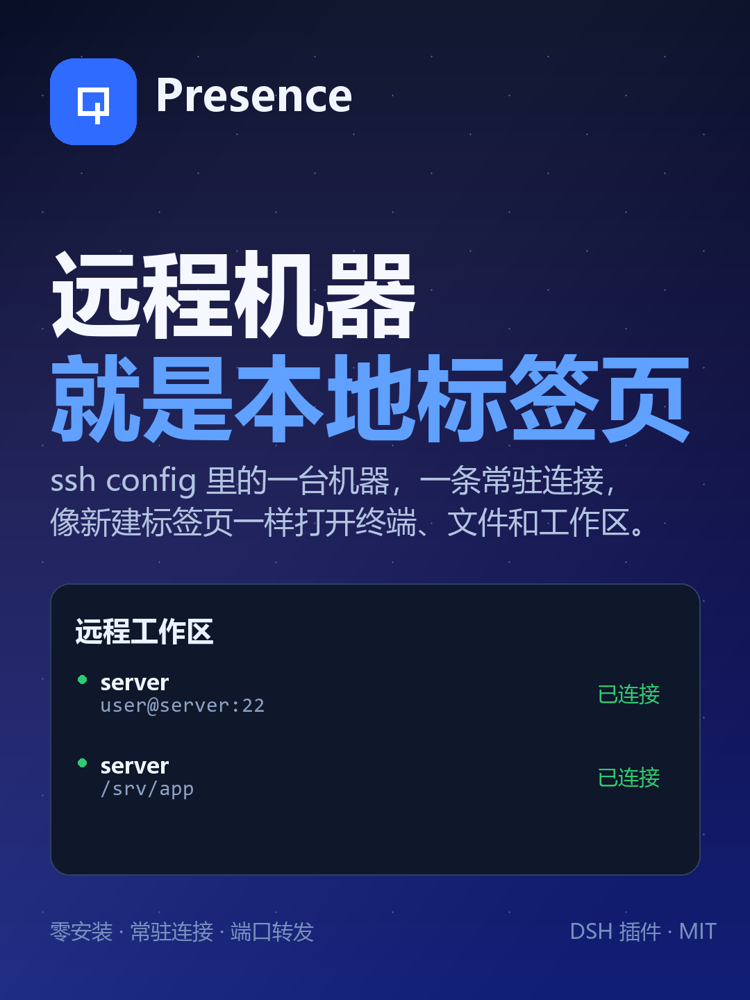

<div align="center">


# Presence

**Your SSH hosts, as local tabs.**

Persistent remote workspaces, native file editing, search, exec, terminals and port
forwards for coding agents — with **nothing installed on the remote host**.

[English](README.md) · [简体中文](README.zh-CN.md) · [Releases](docs/RELEASE.md) · [MCP server](mcp/README.md)

[](https://www.npmjs.com/package/@rjfan/dsh-presence)
[](https://www.npmjs.com/package/presence-mcp)
[](LICENSE)
[](https://github.com/awesome-dsh-plugin/awesome-dsh-plugin)

</div>



---

## Why

Running an agent on every remote machine means installing it N times, upgrading it N
times and configuring proxies per host. Running `ssh host '<command>'` from the local
agent means a new handshake per command, no native file tools and no continuity.

Presence keeps the agent local and **extends its reach through one persistent SSH
connection per host**. The remote side is still plain `sshd`: SFTP, exec and a PTY.

| Approach | Cost |
| --- | --- |
| Install the agent on every host | N installs, N upgrades, per-host proxying |
| `ssh host '<command>'` per call | Handshake per command, no file tools, no sessions |
| **Presence** | One connection per host, native tools, nothing installed remotely |

## Features

- **Remote zero-install** — uses only `sshd` built-ins: the SFTP subsystem, exec channels and a PTY.
- **One handshake** — a pool keeps one connection per host; every later call is a request on it.
- **Native remote tools** — `rg`/`grep` runs on the target, commands run in the target shell; path, permission and encoding semantics are the remote ones.
- **Local-like edits** — atomic writes, mode preservation, ambiguity refusal, read-before-write guard, `presence_edit` with dry-run diffs.
- **Real workspaces** — a remote directory becomes a normal DSH workspace with a file tree and terminals that open **on the remote machine**.
- **Recoverable deletes** — destructive shell commands dry-run first; `presence_trash` moves paths to a remote trash with restore.
- **Two shells, one kernel** — the DSH plugin and a standalone MCP server (`presence-mcp`, 20 tools) share the same kernel.

## Quick start

### 1. Install the DSH plugin

```sh
dsh plugin add @rjfan/dsh-presence@0.17.6
```

From a source checkout:

```sh
dsh plugin add /path/to/dsh-presence
```

### 2. Pick a host and open a workspace

Open **Settings → Presence → New**, choose a host from `~/.ssh/config` (or paste a
manual `ssh` command), then pick a remote folder. It appears as a workspace; the
left sidebar, file tree, terminal and agent tools all use that remote directory.

### 3. Work

```text
You: 把远程 8000 端口转发到本地，然后打开看看
Agent: presence_forward { remotePort: 8000 }
       → http://127.0.0.1:8000
```

## MCP server

The same kernel is available to agents that cannot install DSH plugins (Codex CLI,
Claude Code, OpenCode, Cursor, …).

```sh
npx -y presence-mcp            # 20 tools over stdio
```

```jsonc
// Claude Desktop / OpenCode style
{
  "mcpServers": {
    "presence": {
      "command": "npx",
      "args": ["-y", "presence-mcp"],
      "env": {
        "PRESENCE_HOST": "server",
        "PRESENCE_WORKSPACE": "server:/srv/app"
      }
    }
  }
}
```

See [mcp/README.md](mcp/README.md) for Codex TOML, Claude Code, OpenCode and
Cursor/Windsurf examples.

## How it works

```text
┌───────────────────────────────┐
│  DSH plugin  /  MCP server    │  two shells, one kernel
└──────────────┬────────────────┘
               │
        Presence kernel
        ├── ssh-config   hosts, ports, users, keys, jumps from ~/.ssh/config
        ├── connection   one persistent connection: SFTP / exec / PTY + pool + cancel
        └── host pool    one connection per host, created on demand, idle-collected
               │
        SSH (your existing keys, known_hosts, jumps, proxies)
               │
        target: Linux / macOS, stock sshd
```

| Agent operation | Channel | Remote dependency |
| --- | --- | --- |
| read / write / edit / list / stat | SFTP subsystem | `sftp-server` (stock sshd) |
| exec, search (`rg`/`grep`), git | exec channel | commands already on the host |
| interactive terminal | shell channel + PTY | the host's login shell |

Measured on a Linux host:

| Operation | Latency |
| --- | --- |
| `ssh host '<cmd>'` (new connection every time) | 520–540 ms |
| Presence connect (one handshake, key auth) | 145 ms |
| Presence `sftp stat` | p50 0.6 ms / p95 0.9 ms |
| Presence `exec true` (new channel + shell) | p50 7.6 ms |
| 8 concurrent exec channels | 15 ms total |

> Keep TCP_NODELAY on: without it, request/response hits delayed ACK and p95 goes
> from 0.9 ms to 48 ms.

## Tools

The DSH plugin exposes 18 tools. Relative paths resolve against the active remote
workspace; `host` is optional inside a workspace.

<details>
<summary><b>Show all tools</b></summary>

| Tool | What it does |
| --- | --- |
| `presence_hosts` | List SSH hosts, connection state and default host (`format:"json"` supported). |
| `presence_connect` | Open/reuse a host connection and report the remote identity. |
| `presence_exec` | Run a remote command; `pipefail`, `background`, `waitForPort`, structured JSON, `script`, `saveStdout`; destructive commands dry-run first. |
| `presence_jobs` | Manage background jobs: `list`, `status`, `wait` (with `timedOut`), `stop` (with `alive`/`verified`/`portReleased`), `purge`. |
| `presence_read` | Read a remote file with line numbers, `offset`/`limit`, or `raw:true` for verbatim content. |
| `presence_read_many` | Read 1–50 remote files in one call, with per-file byte/line caps. |
| `presence_write` | Atomic write; preserves mode; returns real mode, size and full sha256; `ifMatchSha256` optimistic lock. |
| `presence_edit` | Exact-text replacement or line-range replacement, with compact diff, `dryRun`, JSON fields. |
| `presence_ls` | List a directory; `recursive`, `totalBytes`, JSON output. |
| `presence_stat` | Batch `stat` for 1–100 paths: type, size, mode, mtime, optional sha256; missing paths return `exists:false`. |
| `presence_search` | Remote `rg`/`grep` search, count-only mode, JSON matches. |
| `presence_glob` | Find remote files by glob with size/mtime. |
| `presence_import` | Local → remote binary-safe upload with mode and sha256. |
| `presence_export` | Remote → local real file (content-addressed), for preview or native apps. |
| `presence_forward` | Forward a remote port to `127.0.0.1`; open/list/close with JSON. |
| `presence_port_probe` | Check listeners and TCP reachability for up to 20 ports; `expect:open|closed`, polling. |
| `presence_http_probe` | Wait for port → forward → local HTTP assertions → close → verify the local port was released. |
| `presence_terminal` | Persistent PTY: `open` with `cwd`/`command`, `write` (`ackOnly`), `read`, `close`; tmux-backed sessions survive reconnects. |
| `presence_trash` | Recoverable delete: move to remote trash, list/restore; batch `paths[]`; returns `sourceRemoved` and `restoreHint`. |

</details>

## Safety and recovery

- **Destructive commands never run unconfirmed.** `rm -r/-f`, `git clean -fdx`,
  `find -delete`, `shred`, `truncate` and `dd of=` are first replayed with
  no-op shims to expand their real targets; unset variables and protected paths
  (workspace root, home, `/`, `.git`) are refused. A second call with
  `confirm:true` is required to execute.
- **Prefer `presence_trash`** for anything under a workspace: it moves the path to
  `~/.dsh/presence-trash/<timestamp>/` and returns a restore hint.
- **Writes are atomic** and keep the original file mode; `presence_edit` refuses
  ambiguous anchors instead of guessing.
- **Read before write**: built-in `read`/`write`/`edit` share a read-before-write
  guard; `presence_write` records the observation so both APIs can be mixed.

## Configuration

The plugin reads these environment variables on the host process:

| Variable | Default | Meaning |
| --- | --- | --- |
| `PRESENCE_HOST` | — | Default SSH host (alias from `~/.ssh/config` or a manual host). |
| `PRESENCE_WORKSPACE` | — | `host:/abs/path` to bind a remote workspace. |
| `PRESENCE_PASSWORD_<ALIAS>` | — | Password for a host; `<ALIAS>` is uppercase with non-alphanumerics replaced by `_`. |
| `PRESENCE_MAX_CHANNELS` | 8 | Concurrent channels per connection. |
| `PRESENCE_CONNECT_TIMEOUT_MS` | 25000 | Connection attempt timeout. |
| `PRESENCE_IDLE_TIMEOUT_MS` | 900000 | Idle connection timeout (connections with terminals are kept). |
| `PRESENCE_READ_ONLY` | false | Refuse writes/edits; reads, search and exec still work. |

Full configuration and the path/permission matrix are in
[docs/VERIFICATION.md](docs/VERIFICATION.md) and [docs/HANDOFF.md](docs/HANDOFF.md).

## Development

```sh
npm install
npm install --prefix .dev --ignore-scripts rollup @rollup/plugin-node-resolve \
  @rollup/plugin-commonjs @rollup/plugin-terser codemirror @codemirror/language-data \
  @codemirror/theme-one-dark
node scripts/build-client.mjs
powershell -NoProfile -ExecutionPolicy Bypass -File scripts/package.ps1 -Version 0.17.6
# → dist/presence-plugin-0.17.6.zip
```

Tests require one SSH-reachable host:

```sh
node scripts/regression.mjs server     # transport, symlinks, timeouts, binary
node scripts/job-probe.mjs server      # jobs + port forwarding
node scripts/feature-probe.mjs server  # wait, sessions, pgid, readiness, search
node scripts/import-probe.mjs server   # local→remote binary, mode, sha256
node scripts/safety-probe.mjs server   # destructive guard + observation store
```

## Known limits

- The mount path (`~/.dsh/presence/mounts/...`) is virtual: it works through
  `ctx.fs` / agent tools, but native apps (Explorer, Office, host Python) cannot
  see it — use `presence_export` first.
- SSH `MaxSessions` (default 10) bounds concurrent channels; the pool uses at most 8.
- PTY terminals follow the connection; cross-reconnect shells need `tmux` on the target
  (used automatically by `presence_terminal { session }`).
- ProxyJump/ProxyCommand are parsed and warned about, but not used for dialing yet.

## Contributing

Issues and PRs are welcome. For a feature, open an issue describing the remote
workflow you want; for a fix, keep the diff focused and add a probe under
`scripts/` when behavior changes.

## License

[MIT](LICENSE)

## Star History

[](https://star-history.com/#fanrj3/dsh-presence&Date)
