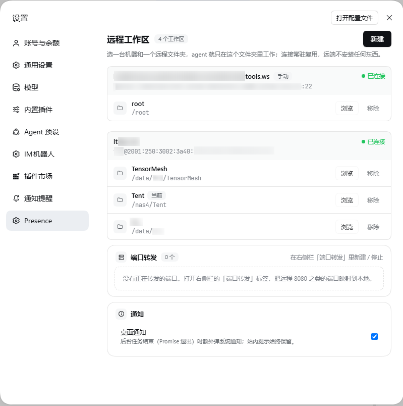
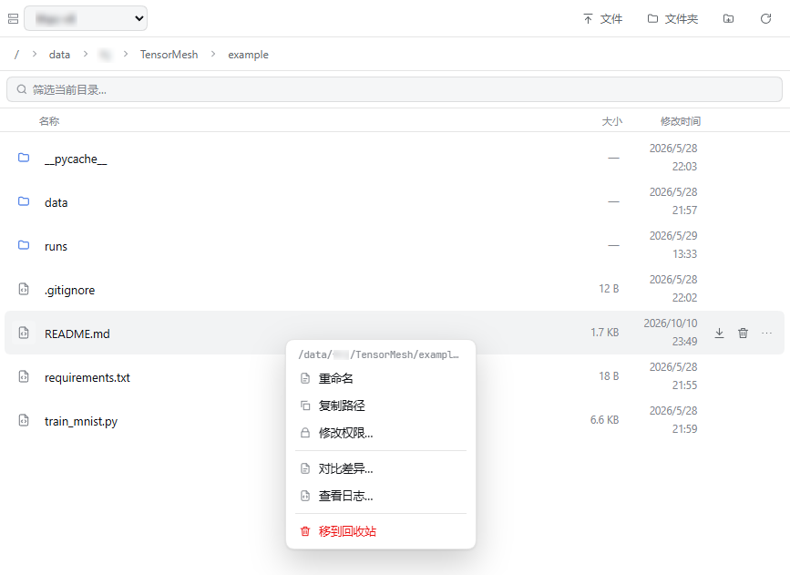
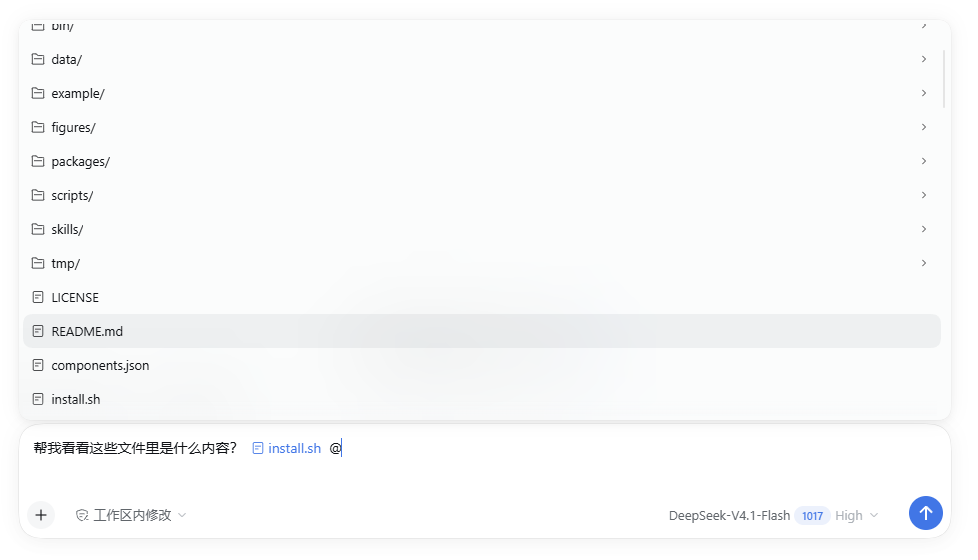
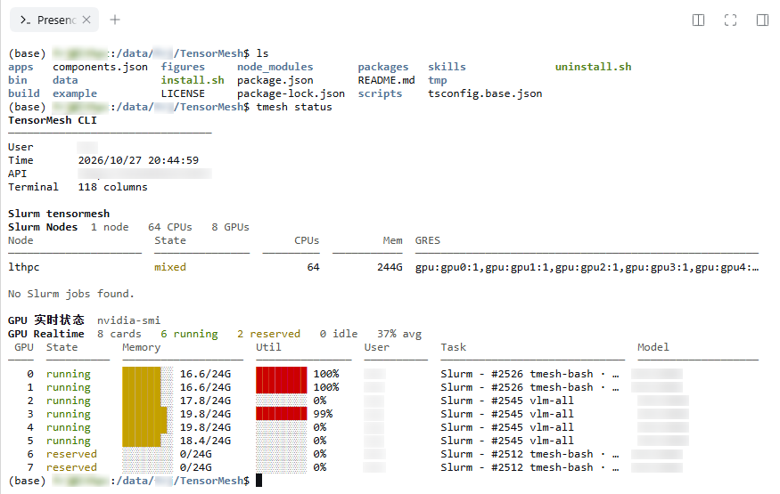
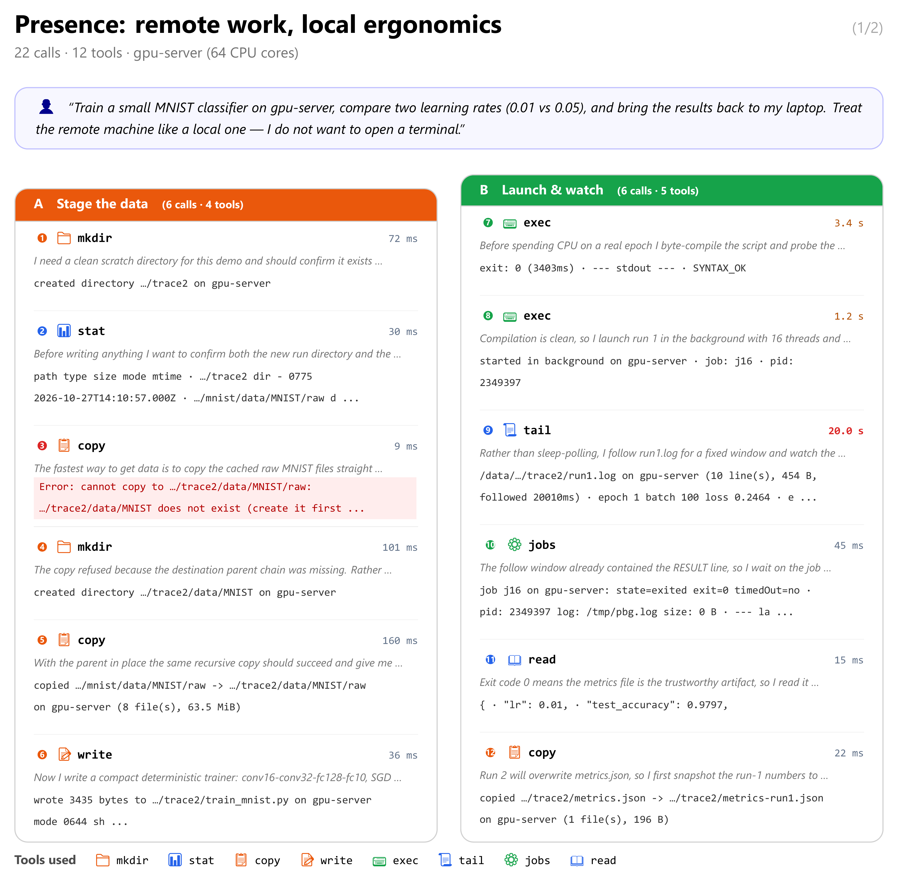
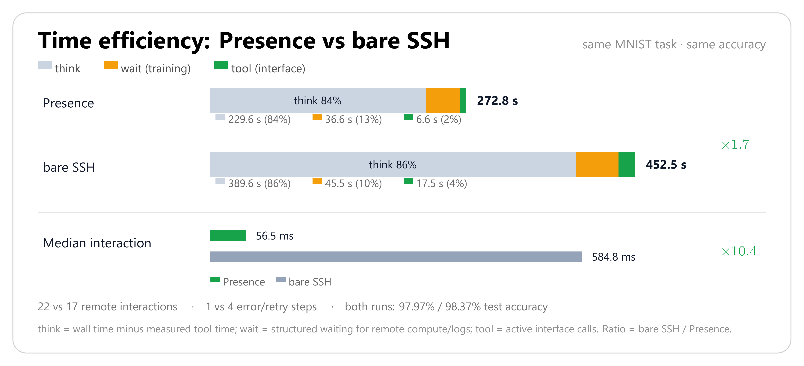

<div align="center">


# Presence

**Your SSH hosts, as local tabs.**

Persistent remote workspaces, native file editing, search, exec, terminals and port
forwards for coding agents — with **nothing installed on the remote host**.

[English](README.md) · [简体中文](README.zh-CN.md) · [Releases](docs/RELEASE.md) · [MCP server](mcp/README.md)

[](https://www.npmjs.com/package/@rjfan/dsh-presence)
[](https://www.npmjs.com/package/presence-mcp)
[](LICENSE)
[](https://github.com/awesome-dsh-plugin/awesome-dsh-plugin)

</div>


---

> ⚠️ **A local session is not bound to a remote workspace.** Opening a remote workspace in
> Presence does not turn a local agent session into a remote one. When your session's
> working directory is outside the presence mounts root, `presence_exec` and every other
> `presence_*` tool require an explicit `host` (or `PRESENCE_HOST`); without one they refuse
> with the session's cwd instead of silently running on the last-activated machine. Sessions
> started inside a remote workspace resolve to that machine automatically. See
> [Known limits](#known-limits).

## Why

Running an agent on every remote machine means installing it N times, upgrading it N
times and configuring proxies per host. Running `ssh host '<command>'` from the local
agent means a new handshake per command, no native file tools and no continuity.

Presence keeps the agent local and **extends its reach through one persistent SSH
connection per host**. The remote side is still plain `sshd`: SFTP, exec and a PTY.

| Approach | Cost |
| --- | --- |
| Install the agent on every host | N installs, N upgrades, per-host proxying |
| `ssh host '<command>'` per call | Handshake per command, no file tools, no sessions |
| **Presence** | One connection per host, native tools, nothing installed remotely |

## Features

- **Remote zero-install** — uses only `sshd` built-ins: the SFTP subsystem, exec channels and a PTY.
- **One handshake** — a pool keeps one connection per host; every later call is a request on it.
- **Native remote tools** — `rg`/`grep` runs on the target, commands run in the target shell; path, permission and encoding semantics are the remote ones.
- **Local-like edits** — atomic writes, mode preservation, ambiguity refusal, read-before-write guard, `presence_edit` with dry-run diffs.
- **Real workspaces** — a remote directory becomes a normal DSH workspace with a file tree and terminals that open **on the remote machine**.
- **Sessions are scoped (0.20 hotfix)** — a local session no longer silently borrows the last-activated remote workspace: `presence_*` needs an explicit `host` or `PRESENCE_HOST`, and the system prompt tells each session whether it is local or remote.
- **Conditions instead of sleeps** — `presence_wait` blocks on a file (`exists`/`minBytes`/`mtimeAfter`), a grep match count, a process (`pid`/`pattern`), a port state or a job id; a timeout is `met:false`, not an error.
- **Jobs that survive a restart** — background jobs are persisted to `~/.dsh/presence/jobs.json` with pid/pgid. `logPath` is the job log to tail; `commandLogPath` is the command's own log and equals `logPath` on current kernels (a separate wrapper log only exists when a kernel records one) — use `commandLogPath ?? logPath`. After a restart their state is `unknown` until probed — never a false `running`, and an exit code may be missing.
- **Batch transfer and append** — `presence_import`/`presence_export` take `paths[]` (1–50) or a glob and return per-file results; `presence_write { mode:"append" }` appends without rewriting the file.
- **Recoverable deletes** — destructive shell commands dry-run first; `presence_trash` moves paths to a remote trash with restore.
- **`@` completes remote files** — inside a remote workspace, file-reference completion indexes the machine itself (`rg --files`, `find` fallback), not a local mirror.
- **File operations, not just reads** — `presence_mkdir` / `move` / `copy` / `chmod` plus a right-click menu in the file tree; deletes go to the recoverable trash.
- **Diff and live logs** — unified diff between two remote files or a remote file and a local one; follow a log file from the panel without keeping a `tail -f` job around.
- **Ports that come back** — save forwards with auto-restore on reconnect, and let the Ports panel discover newly listening ports and forward them with one click.
- **Job notifications** — a toast (and desktop notification) when a background job finishes, plus an optional local `notifyCommand` for daemons and phones.
- **Two shells, one kernel** — the DSH plugin and a standalone MCP server (`presence-mcp`, 20 core tools) share the same kernel.

## Screenshots

<table>
  <tr>
    <td width="50%"></td>
    <td width="50%"></td>
  </tr>
  <tr>
    <td align="center"><sub><b>Settings</b> — every host and folder is a local tab</sub></td>
    <td align="center"><sub><b>Remote workspace</b> — the file tree and editor are on the host</sub></td>
  </tr>
  <tr>
    <td width="50%"></td>
    <td width="50%"></td>
  </tr>
  <tr>
    <td align="center"><sub><b>@ files</b> — completion indexes the remote machine itself</sub></td>
    <td align="center"><sub><b>Terminal</b> — the shell runs on the host, not locally</sub></td>
  </tr>
</table>

### A real trajectory

These three figures are rendered from a recorded 22-call session: train an MNIST
classifier twice on a remote 64-core host, compare two learning rates, and export
the result. Every row is one tool call with its measured duration; red rows are
real failures kept verbatim.

<p align="center"></p>

<p align="center"></p>

<p align="center"></p>

<sub>Figure 3 stacks end-to-end time into think / wait / tool. The same task through
bare <code>ssh</code>/<code>scp</code> takes 452.5 s versus 272.8 s, with a 10.4×
higher median interaction latency.</sub>

## Quick start

### 1. Install the DSH plugin

```sh
dsh plugin add @rjfan/dsh-presence@0.21.0
```

From a source checkout:

```sh
dsh plugin add /path/to/dsh-presence
```

### 2. Pick a host and open a workspace

Open **Settings → Presence → New**, choose a host from `~/.ssh/config` (or paste a
manual `ssh` command), then pick a remote folder. It appears as a workspace; the
left sidebar, file tree, terminal and agent tools all use that remote directory.

A session started in that workspace is remote. A session started anywhere else (for
example a normal local project) stays local: it must pass `host` explicitly — or set
`PRESENCE_HOST` — before calling `presence_exec` / `presence_*`.

### 3. Work

```text
You: 把远程 8000 端口转发到本地，然后打开看看
Agent: presence_forward { remotePort: 8000 }
       → http://127.0.0.1:8000
```

## MCP server

The same kernel is available to agents that cannot install DSH plugins (Codex CLI,
Claude Code, OpenCode, Cursor, …).

```sh
npx -y presence-mcp            # 20 tools over stdio
```

```jsonc
// Claude Desktop / OpenCode style
{
  "mcpServers": {
    "presence": {
      "command": "npx",
      "args": ["-y", "presence-mcp"],
      "env": {
        "PRESENCE_HOST": "server",
        "PRESENCE_WORKSPACE": "server:/srv/app"
      }
    }
  }
}
```

See [mcp/README.md](mcp/README.md) for Codex TOML, Claude Code, OpenCode and
Cursor/Windsurf examples.

## How it works

```text
┌───────────────────────────────┐
│  DSH plugin  /  MCP server    │  two shells, one kernel
└──────────────┬────────────────┘
               │
        Presence kernel
        ├── ssh-config   hosts, ports, users, keys, jumps from ~/.ssh/config
        ├── connection   one persistent connection: SFTP / exec / PTY + pool + cancel
        └── host pool    one connection per host, created on demand, idle-collected
               │
        SSH (your existing keys, known_hosts, jumps, proxies)
               │
        target: Linux / macOS, stock sshd
```

| Agent operation | Channel | Remote dependency |
| --- | --- | --- |
| read / write / edit / list / stat | SFTP subsystem | `sftp-server` (stock sshd) |
| exec, search (`rg`/`grep`), git | exec channel | commands already on the host |
| interactive terminal | shell channel + PTY | the host's login shell |

Measured on a Linux host:

| Operation | Latency |
| --- | --- |
| `ssh host '<cmd>'` (new connection every time) | 520–540 ms |
| Presence connect (one handshake, key auth) | 145 ms |
| Presence `sftp stat` | p50 0.6 ms / p95 0.9 ms |
| Presence `exec true` (new channel + shell) | p50 7.6 ms |
| 8 concurrent exec channels | 15 ms total |

> Keep TCP_NODELAY on: without it, request/response hits delayed ACK and p95 goes
> from 0.9 ms to 48 ms.

## Tools

The DSH plugin exposes 25 tools. Inside a remote-workspace session relative paths
resolve against that workspace and `host` is optional; a **local** session must pass
`host` explicitly (or configure `PRESENCE_HOST`) — there is no fallback to the globally
last-activated workspace. Argument aliases are accepted at execute time
(`path`/`file_path`/`filePath`, `old`/`oldString`, `new`/`newString`, `cwd`/`workdir`, …),
so an agent's habitual spelling still works.

<details>
<summary><b>Show all tools</b></summary>

| Tool | What it does |
| --- | --- |
| `presence_hosts` | List SSH hosts, connection state and default host (`format:"json"` supported); `workspace:true` marks this session's machine and `degraded` rows carry the last error. `default` is session-scoped: this session's mounted host or `PRESENCE_HOST`, never a global last-active workspace. |
| `presence_connect` | Open/reuse a host connection and report the remote identity. |
| `presence_exec` | Run a remote command; `pipefail`, `background`, `waitForPort`, structured JSON, `saveStdout`; timeout defaults to 300 s; `progress` normalizes `\r` progress bars; long output spills to a remote file whose path is returned (`tailLines`); text reports start with `host: <alias>  remote cwd: <abs>`; destructive commands dry-run first — `confirm:true` runs the whole command, `confirm:"partial"` runs only the safe segments. A local session must pass `host`. |
| `presence_jobs` | Background jobs: `list`, `status`, `wait` (with `timedOut`), `stop` (with `alive`/`verified`/`portReleased`), `purge`. Jobs persist to `~/.dsh/presence/jobs.json` with `pid`/`pgid`; `logPath` is the job log to tail (the command's stdout/stderr on current kernels) and `commandLogPath` the command's own log — equal to `logPath` on current kernels, so use `commandLogPath ?? logPath`. After a restart, state is `unknown` until a liveness probe succeeds and the exit code may be missing. `/presence/api/state` job rows also carry `pid`, `pgid`, `commandLogPath` and `persisted`. `wait` accepts `label`, `progressPattern` (two capture groups, done and total, e.g. "Epoch\\s+(\\d+)/(\\d+)") and `progressUnit`; the running wait appears in the floating **wait dock** with elapsed, progress, ETA and the last log line. |
| `presence_wait` | Block until exactly one remote condition is true: `file {path, exists?, minBytes?, mtimeAfter?}`, `grep {path, pattern, count?}`, `process {pid\|pattern, alive?}`, `port {port, state:"open"\|"closed"}` or `job {jobId}` (a job condition needs no `host` — the registry knows where it ran). Returns `{ met, timedOut, elapsedMs, observed, condition, polls }`; a timeout is `met:false` and **never an error**. `timeoutMs` default 120 s (cap 1 h), `pollMs`/`intervalMs` default 1000 ms. Optional `label`, `progressTotal` and `progressUnit` feed the same wait dock (file bytes, grep matches, process/port state). |
| `presence_read` | Read a remote file with line numbers, `offset`/`limit`, or `raw:true` for verbatim content. |
| `presence_read_many` | Read 1–50 remote files in one call, with per-file byte/line caps. |
| `presence_write` | Atomic write; preserves mode; returns real mode, size and full sha256; `ifMatchSha256` optimistic lock; `mode:"append"` appends at EOF and reports appended bytes + total size (`ifMatchSha256` is overwrite-only and append rejects it); `mode` also accepts an octal string such as `"755"` to set permissions on an overwrite. |
| `presence_edit` | Exact-text replacement or line-range replacement, with compact diff, `dryRun`, JSON fields. |
| `presence_stat` | Batch `stat` for 1–100 paths: type, size, mode, mtime, optional sha256; missing paths return `exists:false`. |
| `presence_mkdir` | Create a remote directory (recursive by default); idempotent when it already exists. |
| `presence_move` | Rename or move a path inside the same machine; refuses to replace an existing file unless `overwrite:true`. |
| `presence_copy` | Copy a remote file (SFTP stream, or `cp -p` for large files) or a directory with `recursive:true`. |
| `presence_chmod` | Change permissions with an octal mode (`755`, `0644`), optionally recursive. |
| `presence_diff` | Unified diff of two remote files, or a remote file against a local one; context lines and JSON stats. |
| `presence_tail` | Read the last N lines of a remote file, or follow it for a bounded time (`follow:true`, `timeoutMs`). |
| `presence_search` | Remote `rg`/`grep` search, count-only mode, JSON matches. |
| `presence_glob` | Find remote files by glob with size/mtime. |
| `presence_import` | Local → remote binary-safe upload with mode and sha256; batch `paths[]` (1–50) and/or a local `glob` into a `to` directory, with one result per file. |
| `presence_export` | Remote → local real file (content-addressed), for preview or native apps; batch `paths[]` or a remote `glob`; the local name defaults to the basename and a collision becomes `name-<sha8>.ext`; one result per file. A batch skips files recorded in the export manifest (`~/.dsh/presence/exports/manifest.json`) when the remote path, size and mtime still match (`skipExisting:false` re-exports); live progress goes to `~/.dsh/presence/exports/latest.json`, reads use parallel SFTP requests, and each read times out after 30 s instead of hanging the call. |
| `presence_forward` | Forward a remote port to `127.0.0.1`; open/list/close with JSON. |
| `presence_port_probe` | Check listeners and TCP reachability for up to 20 ports; `expect:open|closed`, polling. |
| `presence_http_probe` | Wait for port → forward → local HTTP assertions → close → verify the local port was released. |
| `presence_terminal` | Persistent PTY: `open` with `cwd`/`command`, `write` (`ackOnly`), `read`, `close`; tmux-backed sessions survive reconnects. |
| `presence_trash` | Recoverable delete: move to remote trash, list/restore; batch `paths[]`; returns `sourceRemoved` and `restoreHint`. |

</details>

### Batch transfer and append

```text
presence_export { paths: ["/data/a.pt", "/data/b.pt"] }      # files:[{remotePath, localPath, bytes, sha256}]
presence_export { glob: "/data/ckpt-*.pt" }                   # every match; name-<sha8>.ext on collision
presence_import { glob: "dist/*.whl", to: "/data/wheels" }    # local → remote, one result per file
presence_write { path: "/data/train.log", mode: "append", content: "epoch 6 done\n" }
```

Single-path calls keep the existing `path`/`to` behaviour, so none of this is required for
one file.

## Which tool for which path

| Where the path lives | Use | Why |
| --- | --- | --- |
| under the workspace mount (`~/.dsh/presence/mounts/...`) | built-in `read` / `write` / `edit` / `grep` / `glob` | they reach the remote machine; `grep`/`glob` are routed to it automatically |
| remote absolute path outside the workspace (`/data`, `/scratch`, GPFS) | `presence_read` / `write` / `edit` / `stat` / `search` / `glob` (list a directory with `presence_exec`) | the built-in tools only see the mount, not the rest of the machine |
| local file, for preview or Office | `presence_export` first, then `present` / native open | the mount path is virtual; only a real local file can be opened natively |

In a **local** session (cwd outside the mounts root) the built-in tools only touch local
files; every `presence_*` call needs `host` explicitly, or configure `PRESENCE_HOST` once.

## Long-running tasks

`presence_exec` waits for the command, so it is the wrong tool for a training run, a
build or a server. The recipe:

```text
1. presence_exec { command: "python train.py --lr 3e-4", background: true, label: "train-3e-4" }
   → { id: "j7", pid: 4242, pgid: 4242, logPath: ".../job.log", commandLogPath: ".../job.out" }
2. presence_jobs { action: "wait", jobId: "j7" }      # or presence_wait { job: { jobId: "j7" } }
3. presence_tail { path: <logPath>, follow: true }    # watch progress
   presence_wait { grep: { path: <logPath>, pattern: "epoch 6", count: 1 } }   # readiness
```

- `presence_jobs { action: "status" }` gives a snapshot; `stop` terminates the process
  group and verifies the port was released. Jobs persist to `~/.dsh/presence/jobs.json`:
  after a DSH restart a job shows `unknown` until a liveness probe succeeds (never a false
  `running`) and its exit code may be missing.
- `logPath` is the job log to tail — the command's stdout/stderr on current kernels.
  `commandLogPath` is the command's own log; it equals `logPath` unless the kernel records
  a separate wrapper log, so tail `commandLogPath ?? logPath`.
- `presence_wait` replaces hand-written sleep+tail loops: wait for a port
  (`presence_wait { port: { port: 8000, state: "open" } }`), a checkpoint
  (`presence_wait { file: { path: "/data/ckpt.pt", minBytes: 1000000 } }`), a log line or
  a process. A timeout returns `met:false` — a normal answer, not an error.
- While a wait runs, the **wait dock** floats at the bottom right of the chat: elapsed time,
  `done/total unit`, an ETA computed from the sample rate, the last log line, and a
  click-through detail view (job id, log path, samples). It polls `/presence/api/waits`; an
  older host simply hides it. Pass `progressPattern`/`progressUnit` to `presence_jobs wait`
  or `progressTotal`/`progressUnit` to `presence_wait` when you want a bar and an ETA.
- Interactive work: `presence_terminal { action: "open", session: "train" }` — the
  tmux-backed session survives a reconnect.
- **Do not** start `nohup`, `tmux new-session` or a trailing `&` inside a foreground
  `presence_exec` for long jobs: when the login-node session ends, the cluster may clean
  up what it left behind. `background: true` already detaches through `setsid`; on
  scheduler-managed clusters start the job with the cluster's own launcher
  (`rlaunch -d …`, `salloc`/`sbatch`) so the scheduler owns it.

## Safety and recovery

- **Destructive commands never run unconfirmed.** `rm -r/-f`, `git clean -fdx`,
  `find -delete`, `shred`, `truncate` and `dd of=` are first replayed with
  no-op shims to expand their real targets; unset variables and protected paths
  (workspace root, home, `/`, `.git`) are refused. A second call with
  `confirm:true` is required to execute. A rejected mixed command also lists the
  segments that are safe on their own (`Safe segments you can run separately:`);
  `confirm:"partial"` runs only those. Removing one file with a literal
  `rm -f <path>` inside the workspace is exempt — it cannot remove a tree.
- **Prefer `presence_trash`** for anything under a workspace: it moves the path to
  `~/.dsh/presence-trash/<timestamp>/` and returns a restore hint.
- **Writes are atomic** and keep the original file mode; `presence_edit` refuses
  ambiguous anchors instead of guessing.
- **Read before write**: built-in `read`/`write`/`edit` share a read-before-write
  guard. Path keys are canonicalised across `presence://`, mount paths, workspace-relative
  and absolute remote paths, and successful `presence_read` / `presence_write` /
  `presence_edit` calls count as a read (a write counts too). `presence_exec` running
  `cat file` does **not** count — the guard cannot see shell output; read with
  `presence_read` or the built-in `read` before editing.

## Configuration

The plugin reads these environment variables on the host process:

| Variable | Default | Meaning |
| --- | --- | --- |
| `PRESENCE_HOST` | — | Default SSH host for **local** sessions (explicit opt-in; also used by the MCP server). Remote-workspace sessions ignore it in favour of their mounted host. |
| `PRESENCE_WORKSPACE` | — | `host:/abs/path` to bind a remote workspace. |
| `PRESENCE_JOBS_FILE` | `~/.dsh/presence/jobs.json` | Override the persisted background-job registry path. |
| `PRESENCE_PASSWORD_<ALIAS>` | — | Password for a host; `<ALIAS>` is uppercase with non-alphanumerics replaced by `_`. |
| `PRESENCE_MAX_CHANNELS` | 8 | Concurrent channels per connection. |
| `PRESENCE_CONNECT_TIMEOUT_MS` | 25000 | Connection attempt timeout. |
| `PRESENCE_IDLE_TIMEOUT_MS` | 900000 | Idle connection timeout (connections with terminals are kept). |
| `PRESENCE_READ_ONLY` | false | Refuse writes/edits; reads, search and exec still work. |

Full configuration and the path/permission matrix are in
[docs/VERIFICATION.md](docs/VERIFICATION.md) and [docs/HANDOFF.md](docs/HANDOFF.md).

## Development

```sh
npm install
npm install --prefix .dev --ignore-scripts rollup @rollup/plugin-node-resolve \
  @rollup/plugin-commonjs @rollup/plugin-terser codemirror @codemirror/language-data \
  @codemirror/theme-one-dark
node scripts/build-client.mjs
powershell -NoProfile -ExecutionPolicy Bypass -File scripts/package.ps1 -Version 0.21.0
# → dist/presence-plugin-0.21.0.zip
```

After a DSH update, prove the plugin still activates against the shipped runtime
(Electron-as-Node; this is what caught the 0.2.1-rc.5 tool-schema tightening):

```powershell
$env:ELECTRON_RUN_AS_NODE = '1'
& 'C:\...\DeepSeek Harness.exe' scripts\host-compat-check.mjs   # ACTIVATED OK with 25 tools
```

Tests need one SSH-reachable host unless noted:

```sh
node scripts/regression.mjs server     # transport, symlinks, timeouts, binary
node scripts/job-probe.mjs server      # jobs + port forwarding
node scripts/feature-probe.mjs server  # wait, sessions, pgid, readiness, search
node scripts/import-probe.mjs server   # local→remote binary, mode, sha256
node scripts/safety-probe.mjs server   # destructive guard + observation store
node scripts/p0-guard-probe.mjs        # guard split/partial/single-rm (no host needed)
node scripts/p1-docs-probe.mjs         # README/zh/RELEASE anchors (no host needed)
```

## Known limits

- **Local sessions.** A local session calling `presence_*` without `host` now raises
  `this session is local (cwd=...); pass an explicit host ...`. That is the intended 0.20
  behavior, not a bug: the old silent fallback to the last-activated remote workspace could
  run commands on another session's machine. Pass `host` per call, or set `PRESENCE_HOST`
  once as the explicit opt-in default; a local session still never inherits another
  session's workspace, and `presence_hosts`' `default` is session-scoped for the same reason.
- The read-before-write guard cannot observe shell output: `presence_exec { command:
  "cat file" }` (or `sed -n`) does **not** mark the file as read; `presence_read` and the
  built-in `read` do, and `presence_write`/`presence_edit` count as reads. A guarded
  built-in `edit` after only `exec cat` can still fail.
- The mount path (`~/.dsh/presence/mounts/...`) is virtual: it works through
  `ctx.fs` / agent tools, but native apps (Explorer, Office, host Python) cannot
  see it — use `presence_export` first.
- `presence_exec` defaults to a 300 s timeout; longer work must use `background: true`
  (foreground output over the cap is spilled to a remote file, and `tailLines` keeps the
  end of a long report). Background jobs persist to `~/.dsh/presence/jobs.json`; after a
  DSH restart their state is `unknown` until a liveness probe succeeds — never assume a
  persisted job is still running, and its exit code may be missing. Tail
  `commandLogPath ?? logPath` (`logPath` holds the command output on current kernels).
- `presence_export` moves at most 64 MiB per file and processes a batch sequentially.
  Progress is written to `~/.dsh/presence/exports/latest.json` while it runs, a stalled
  read fails after 30 s instead of hanging the call, and a re-run skips files recorded in
  the export manifest with the same remote path, size and mtime
  (`~/.dsh/presence/exports/manifest.json`). For multi-GB transfers over a slow WAN use
  `scp`/`rsync`/`tar` from a shell instead of a single export call.
- A login node may clean up processes left behind when a session closes: do not rely on
  `nohup` / `tmux new-session` / `&` started inside a foreground `presence_exec` for long
  jobs. Use `background: true` (detached with `setsid`) or `presence_terminal` (tmux),
  and let the cluster scheduler own the job where required (`rlaunch -d`, `salloc`/`sbatch`).
- Argument aliases are accepted (`path`/`file_path`/`filePath`, `old`/`oldString`,
  `new`/`newString`, `replaceAll`/`replace_all`, `dryRun`/`dry_run`, `cwd`/`workdir`);
  the canonical name is what the tool schema documents.
- SSH `MaxSessions` (default 10) bounds concurrent channels; the pool uses at most 8.
- PTY terminals follow the connection; cross-reconnect shells need `tmux` on the target
  (used automatically by `presence_terminal { session }`).
- ProxyJump/ProxyCommand are parsed and warned about, but not used for dialing yet.
- `@` file completion indexes the remote tree lazily (about 10 s per workspace);
  on a very large tree the first query can take a few seconds.
- Port auto-restore runs when the connection is re-established; a forward whose
  saved local port is already taken falls back to another free port.

## Contributing

Issues and PRs are welcome. For a feature, open an issue describing the remote
workflow you want; for a fix, keep the diff focused and add a probe under
`scripts/` when behavior changes.

## License

[MIT](LICENSE)

## Star History

[](https://star-history.com/#fanrj3/dsh-presence&Date)
